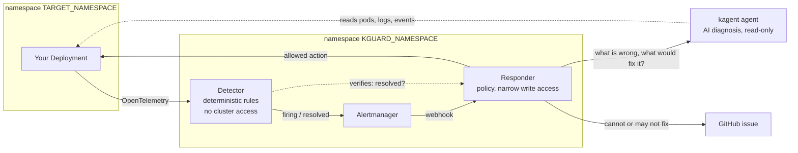

# KGuard: the agent on call

KGuard finds the cause of a Kubernetes incident, fixes the ones it is allowed to fix, verifies the fix, and hands
everything else to a human with its diagnosis. **The AI only proposes; fixed rules decide, and Kubernetes enforces
what may change.**

This repository holds the concept and the minimal manifests to set it up for one application in one namespace.

## How it works



| Part | Job | Can change the cluster? |
|---|---|---|
| **Detector** | Watches telemetry with fixed rules (latency, failed connections, crash loops, no ready pods, memory forecast) and raises alerts | No |
| **kagent agent** | Diagnoses the alert: cause, confidence, proposed action | No (read-only tools, no Secrets) |
| **Responder** | Checks the proposal against its policy, executes it, waits for the detector to confirm recovery, otherwise opens a GitHub issue | Only the allow-listed Deployment |

### One incident

1. The detector fires an alert with per-pod evidence.
2. The responder asks the kagent agent for a diagnosis. The agent answers with a JSON block:
   `summary`, `root_cause`, `confidence`, `action` (`restart-pod`, `rollout-restart`, `rollback`, `none`), `target`,
   `fix_by` (`kagent`, `code`, `config`, `human`) and `evidence`.
3. The responder's policy accepts the action only if all hold: allowed action, target owned by an allow-listed
   Deployment (never a StatefulSet), the pod was reported as affected, confidence at least `medium`, at most one
   action per Deployment within the cooldown, and at most 3 per day.
4. It acts under the action's autonomy level (below).
5. The fix counts only when the detector resolves the alert within a few minutes. Otherwise it escalates.
6. Every fix still opens a follow-up issue for the cause: a restart clears the symptom, not the bug.

### Why it is safe to let it act

- **The AI is not needed to act safely.** If kagent is unavailable, a default action per alert goes through the
  same policy and verification.
- **The AI never holds the keys.** The agent can only read. The responder executes, after a deterministic check.
- **The one that acts does not grade itself.** A fix counts only when the detector independently sees recovery.
- **Kubernetes enforces the limits** even if the responder's code is wrong or its token is stolen: RBAC by
  resource name and two `ValidatingAdmissionPolicy`s ([`manifests/responder-guardrails.yaml`](manifests/responder-guardrails.yaml)).
- **Never automated:** databases and data, Secrets and credentials, anything outside the target namespace.

### Autonomy per action

| Level | What happens |
|---|---|
| `shadow` | Nothing changes. The issue says what it would have done |
| `approve` | A human approves or rejects; the policy is checked again before acting |
| `auto` | It acts at once |

Start every action in `shadow`, record how often the proposal was right, then promote one action at a time.

### What it fixes, and what it does not

KGuard acts only where Kubernetes does not heal the problem by itself, or heals it too late:

| Fault | Why Kubernetes does not fix it | KGuard does |
|---|---|---|
| One pod is slow, the others are fine | The pod is alive and ready | Restarts that pod |
| A credential was rotated, pods hold the old one | Pods are not restarted when a Secret changes | Rollout restart |
| Memory slowly runs out | It only reacts after the crash | Replaces pods one at a time, before the heap is full |
| A new revision crash-loops, the old one was healthy | It keeps restarting the broken revision | Rollback |

Where a restart would not help (the database itself is slow, a wrong value in config, a code bug) it opens a GitHub
issue with its diagnosis instead.

## Configure it for your cluster and namespace

You need: kagent installed in the cluster, a detector that sends alerts to Alertmanager, and a responder that
receives Alertmanager's webhook (the responder's contract is described above). Kubernetes 1.30+ for
`ValidatingAdmissionPolicy`.

1. **Pick the values** for your setup:

   ```bash
   export TARGET_NAMESPACE=my-app            # namespace of the workload KGuard may heal
   export APP_DEPLOYMENT=my-app              # the one Deployment it may restart or roll back
   export KGUARD_NAMESPACE=kguard            # namespace of the responder (no chaos experiments here)
   export KAGENT_NAMESPACE=kagent            # namespace where kagent is installed
   export IMAGE_PREFIX=registry.example.com/my-team/   # rollbacks may only use images from here
   ```

2. **Check the kube context** is the cluster you mean to change:

   ```bash
   kubectl config current-context
   ```

3. **Model for the agent.** Create the API key Secret, then the ModelConfig (edit provider and model in the file):

   ```bash
   kubectl -n "$KAGENT_NAMESPACE" create secret generic kguard-llm --from-literal=API_KEY=<your key>
   envsubst < manifests/kagent-modelconfig.yaml | kubectl apply -f -
   ```

4. **The read-only diagnosis agent:**

   ```bash
   envsubst < manifests/kagent-incident-agent.yaml | kubectl apply -f -
   ```

   Add what the agent should know about your system to its `systemMessage` (other workloads it must never touch,
   how your app reads config). Its A2A endpoint is
   `http://kagent-controller.$KAGENT_NAMESPACE.svc:8083/api/a2a/$KAGENT_NAMESPACE/kguard-incident-agent/`.

5. **Guard rails for the responder** (ServiceAccount, Role, admission policies):

   ```bash
   kubectl create namespace "$KGUARD_NAMESPACE" --dry-run=client -o yaml | kubectl apply -f -
   envsubst < manifests/responder-guardrails.yaml | kubectl apply -f -
   ```

   Run the responder as the ServiceAccount `kguard-responder` in `$KGUARD_NAMESPACE`.

6. **Point the responder** at the agent URL above, at Alertmanager, and at the GitHub repository for issues
   (a token with Issues read and write, stored as a Secret). Start with every action in `shadow`.

7. **Prove the guard rails** before going beyond shadow, with the responder's token:

   ```bash
   kubectl auth can-i delete pods -n "$TARGET_NAMESPACE" --as=system:serviceaccount:$KGUARD_NAMESPACE:kguard-responder        # yes
   kubectl auth can-i patch deployment/other -n "$TARGET_NAMESPACE" --as=system:serviceaccount:$KGUARD_NAMESPACE:kguard-responder  # no
   kubectl auth can-i get secrets -n "$TARGET_NAMESPACE" --as=system:serviceaccount:$KGUARD_NAMESPACE:kguard-responder        # no
   ```

## Audit record

Every decision is written as a Kubernetes Event on the Deployment it concerns (`KGuardAction`, `KGuardVerified`,
`KGuardShadow`, `KGuardAwaitingApproval`, `KGuardEscalated`):

```bash
kubectl -n "$TARGET_NAMESPACE" get events --field-selector involvedObject.name="$APP_DEPLOYMENT" | grep KGuard
```

Events expire after an hour by default; keep them longer with an event exporter or your log pipeline.
