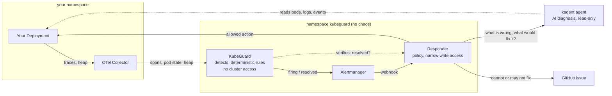

# KGuard: the agent on call

KGuard finds the cause of a Kubernetes incident, fixes the ones it is allowed to fix, verifies the fix, and hands
everything else to a human with its diagnosis. **The AI only proposes; fixed rules decide, and Kubernetes enforces
what may change.**

## How it works



| Part | Job | Can change the cluster? |
|---|---|---|
| **KubeGuard** | Watches telemetry with fixed rules (latency, failed connections, crash loops, no ready pods, stuck pods, memory forecast) and raises alerts | No |
| **kagent agent** | Diagnoses the alert: cause, confidence, proposed action | No (read-only tools, no Secrets) |
| **Responder** | Checks the proposal against its policy, executes it, waits for KubeGuard to confirm recovery, otherwise opens a GitHub issue | Only the allow-listed Deployment |

### One incident

1. KubeGuard fires an alert with per-pod evidence.
2. The responder asks the kagent agent for a diagnosis over A2A. The agent ends its answer with a JSON block:
   `summary`, `root_cause`, `confidence`, `action` (`restart-pod`, `rollout-restart`, `rollback`, `none`), `target`,
   `fix_by` (`kagent`, `code`, `config`, `human`) and `evidence`.
3. The policy accepts the action only if all hold: allowed action, target owned by an allow-listed Deployment
   (never a StatefulSet), the pod was reported as affected, confidence at least `medium`, at most one action per
   Deployment within the cooldown, and a repeat limit per day. A rollback also needs a stuck newest revision.
4. It acts under the action's autonomy level (below).
5. The fix counts only when KubeGuard resolves the alert within 4 minutes. Otherwise it escalates.
6. Every fix still opens a follow-up issue for the cause: a restart clears the symptom, not the bug.

### Why it is safe to let it act

- **The AI is not needed to act safely.** If kagent is unavailable, a default action per alert goes through the
  same policy and verification.
- **The AI never holds the keys.** The agent can only read. The responder executes, after a deterministic check.
- **The one that acts does not grade itself.** A fix counts only when KubeGuard independently sees recovery.
- **Kubernetes enforces the limits** even if the responder's code is wrong or its token is stolen: RBAC by resource
  name and two `ValidatingAdmissionPolicy`s (`helm/kubeguard-demo/templates/responder.yaml`).
  `scripts/test-responder-guardrails.sh` proves it with 30 cases on a throwaway k3s cluster.
- **Never automated:** databases and data, Secrets and credentials, anything outside the target namespace.

### Autonomy per action

| Level | What happens |
|---|---|
| `shadow` | Nothing changes. The issue says what it would have done (chart default) |
| `approve` | A human approves or rejects; the policy is checked again before acting |
| `auto` | It acts at once |

Start every action in `shadow`, judge each run (`POST /api/incidents/verdict`), read the pilot report
(`GET /api/report`), then promote one action at a time.

### What it fixes, and what it does not

| Fault | Why Kubernetes does not fix it | KGuard does |
|---|---|---|
| One pod is slow, the others are fine | The pod is alive and ready | Restarts that pod |
| A credential was rotated, pods hold the old one | Pods are not restarted when a Secret changes | Rollout restart |
| Memory slowly runs out | It only reacts after the crash | Replaces pods one at a time, before the heap is full |
| A new revision crash-loops, the old one was healthy | It keeps restarting the broken revision | Rollback |

Where a restart would not help (the database itself is slow, a wrong value in config, a code bug) it opens a GitHub
issue with its diagnosis instead.

## Repository

| Path | What |
|---|---|
| `kubeguard/` | Detector (Quarkus, Kotlin). Reads OTLP/HTTP JSON, evaluates rules, sends alerts to Alertmanager |
| `kubeguard-responder/` | Responder (Quarkus, Kotlin). Alertmanager webhook → kagent → policy → action → verify, or GitHub issue |
| `helm/kubeguard-demo/` | Chart for KubeGuard, Alertmanager, responder and its guard rails, plus optional demo targets |
| `kagent/` | Values for the kagent chart, the ModelConfig and the read-only incident agent |
| `otel-collector/` | The pipelines your app's OpenTelemetry Collector needs to feed KubeGuard |
| `demo/mock-backend/` | Optional mock service that produces traffic for the demo scenarios |
| `chaos-mesh/experiments/` | Chaos Mesh experiments and Jobs to trigger the scenarios |
| `scripts/` | Guard-rail test (k3s in Docker) and a demo helper |

## Build and test

Java 17+. The Gradle wrapper is included.

```bash
./gradlew -p kubeguard test
./gradlew -p kubeguard-responder test
scripts/test-responder-guardrails.sh       # needs Docker, kubectl, helm, python3; never uses your kubeconfig
helm lint helm/kubeguard-demo
```

Build and push the images to your registry with Jib (no Docker daemon needed):

```bash
for p in kubeguard kubeguard-responder demo/mock-backend; do
  ./gradlew -p $p quarkusBuild -Dquarkus.container-image.build=true -Dquarkus.container-image.push=true \
    -Dquarkus.container-image.registry=registry.example.com -Dquarkus.container-image.group=kguard --rerun-tasks
done
```

## Configure it for your cluster and namespace

The defaults use placeholders. Replace them with your values:

| Placeholder | Meaning | Where |
|---|---|---|
| `my-namespace` | Namespace of the workload KGuard may heal | `helm/kubeguard-demo/values.yaml` (`responder.targetNamespace`), `kagent/values.yaml`, `kagent/manifests/kubeguard-incident-agent.yaml`, `otel-collector/` |
| `my-app` | The Deployment it may restart or roll back | `responder.allowedDeployments`, `kubeguard.services` in `kubeguard.properties`, `mockBackend.backendLoadUrl`, the agent's prompt |
| `my-app-postgresql` | A workload the agent must never act on | The agent's prompt |
| `registry.example.com/kguard` | Where you pushed the KubeGuard images | `*.image.repository` in the chart values |
| `registry.example.com/my-team/` | Your app's image prefix; rollbacks may only use images from here | `responder.rollbackImagePrefixes` |
| `my-cluster` | Label on every alert | `kubeguard.properties` |
| `my-org/my-repo` | GitHub repository for escalation issues | `responder.githubRepository` |

Check the kube context first; only the cluster you mean to change:

```bash
kubectl config current-context
```

1. **kagent** with read-only tools scoped to your namespace (Kubernetes 1.30+ for the admission policies):

   ```bash
   kubectl create namespace kagent
   kubectl -n kagent create secret generic kagent-openai --from-literal=OPENAI_API_KEY=<key>
   helm upgrade --install kagent-crds oci://ghcr.io/kagent-dev/kagent/helm/kagent-crds --version 0.10.6 -n kagent
   helm upgrade --install kagent oci://ghcr.io/kagent-dev/kagent/helm/kagent --version 0.10.6 -n kagent -f kagent/values.yaml
   kubectl apply -f kagent/manifests/modelconfig.yaml -f kagent/manifests/kubeguard-incident-agent.yaml
   ```

   Tell the agent about your system in its `systemMessage`: what the Deployment is, which workloads it must never
   touch, how your app reads config.

2. **KubeGuard, Alertmanager and the responder** in their own namespace, never targeted by chaos experiments:

   ```bash
   kubectl create namespace kubeguard
   kubectl -n kubeguard create secret generic kubeguard-responder-github --from-literal=GITHUB_TOKEN=<token with Issues read/write>
   helm upgrade --install kubeguard helm/kubeguard-demo -n kubeguard -f helm/kubeguard-demo/values-kubeguard.yaml
   ```

   `values-kubeguard.yaml` sets every action to `auto` for a demo. Drop that part to keep the chart default,
   `shadow`. `responder.dryRun: true` is a kill switch for all actions.

3. **Feed KubeGuard.** Merge `otel-collector/kubeguard-pipeline.yaml` into your app's OpenTelemetry Collector. Your
   app must emit traces (CLIENT spans for outgoing calls and JDBC, SERVER spans for requests) and, for the memory
   forecast, Micrometer JVM metrics.

4. **Optional demo targets** (mock service, two stubs, its own collector) in a namespace Chaos Mesh may target:

   ```bash
   kubectl create namespace kubeguard-demo
   kubectl annotate namespace kubeguard-demo chaos-mesh.org/inject=enabled
   helm upgrade --install kubeguard-demo helm/kubeguard-demo -n kubeguard-demo -f helm/kubeguard-demo/values-targets.yaml
   ```

5. **Prove the guard rails** in your cluster with the responder's identity:

   ```bash
   SA=system:serviceaccount:kubeguard:kubeguard-responder
   kubectl auth can-i delete pods -n my-namespace --as=$SA                  # yes
   kubectl auth can-i patch deployment/my-app -n my-namespace --as=$SA      # yes
   kubectl auth can-i patch deployment/other -n my-namespace --as=$SA       # no
   kubectl auth can-i get secrets -n my-namespace --as=$SA                  # no
   ```

## Watch it

```bash
scripts/kubeguard-demo.sh watch                                          # incidents and alerts every 5 s
scripts/kubeguard-demo.sh responder                                      # what the responder did, with timelines
kubectl -n kubeguard logs -f deploy/kubeguard | grep transition          # NORMAL → DEGRADED → FIRING → RECOVERED
kubectl -n kubeguard logs -f deploy/kubeguard-responder | grep incident= # diagnosis, decision, action, verification
kubectl -n my-namespace get events --field-selector involvedObject.name=my-app | grep KGuard   # audit record
```

Every decision is written as a Kubernetes Event on the Deployment (`KGuardAction`, `KGuardVerified`, `KGuardShadow`,
`KGuardAwaitingApproval`, `KGuardEscalated`). Events expire after an hour by default; keep them longer with an event
exporter or your log pipeline.

## Limits

- The responder keeps its runs, cooldowns and repeat counts in memory; they start again when it restarts. Export
  `GET /api/report/csv` before a restart.
- The memory forecast needs frequent garbage collection to read the heap floor.
- Log, event and alert text reaches the agent's prompt. The agent is told to treat it as data, and it cannot act,
  but prompt injection through logs is not otherwise mitigated.
